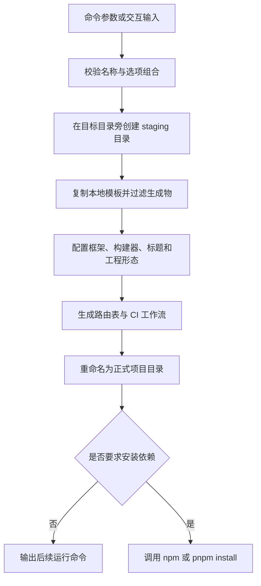
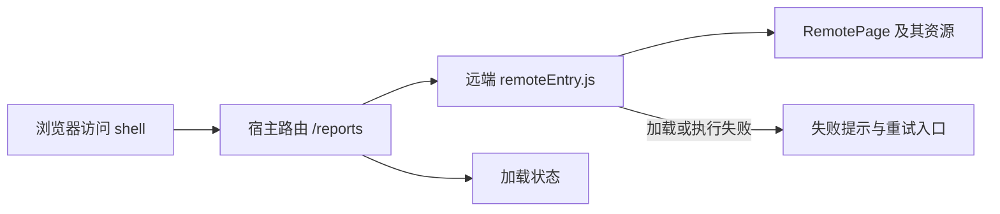

# 从 60 KB 的 npm 包到九种前端工程：拆解 Baize CLI 的架构、构建与交付

> 本文基于 Baize CLI 1.3.0 的实际代码与发布验证，面向希望理解脚手架设计、前端工程化和构建交付的开发者。文中的依赖版本对应这一版本的模板快照。

执行下面这组命令，可以得到一个 Vue 管理后台微前端工作区：

```bash
npm install -g baize-cli@1.3.0
baize create insight-platform --template vue-admin --mode microfrontend
cd insight-platform
pnpm install
pnpm run quality
```

生成的工程包含两个应用：`shell` 负责管理后台的导航、登录和页面容器，`reports` 提供可以独立运行的报表远端。工作区还带有路由生成、类型检查、单元测试、Storybook、CI 和版本化发布脚本。

把模板换成 React，同一套命令仍然成立；React 还支持选择 Webpack。普通单项目、多项目工作区和微前端，也由同一个 CLI 入口生成。

支撑这些能力的 npm 发布压缩包只有 **59,895 字节，约 60 KB，包含 142 个文件**。这个数字仅衡量 CLI 与模板的发布压缩包；CLI 的运行依赖、生成项目的依赖和浏览器构建产物需要分别计量。

这样一套工具值得讨论的地方，在于它如何把技术栈、工程组织方式、构建过程和质量要求组合成一个可以验证的生成过程。

## 一、先看结构：把工程选择变成受约束的输入

Baize 的生成入口可以概括为：

```text
工程 = F(模板、构建器、项目形态、包管理器、可选能力、项目名称)
```

这个函数并不接受任意组合。1.3.0 的基础工程矩阵如下：

| 模板  | 构建器  | 项目形态                       | 基础组合数 |
| ----- | ------- | ------------------------------ | ---------- |
| React | Vite    | single / multi / microfrontend | 3          |
| React | Webpack | single / multi / microfrontend | 3          |
| Vue   | Vite    | single / multi / microfrontend | 3          |

因此，基础结构共有九种。npm/pnpm、项目标题和 React 可选的 WUI 在这个矩阵之上继续变化，九种并不代表全部参数组合。

默认值是 React、pnpm、Vite 和单项目。Vue 选择 Webpack 或 WUI 时，CLI 会在创建目标目录前报错。`--wui` 还会校验更严格的 Node.js 版本范围，并自动启用依赖安装。

这些限制体现了一种维护策略：**一个可选项应对应一条真实可用的工程路径。** 每增加一项自由度，模板变换、依赖声明、测试和构建验证都会随之扩展。

仓库据此划分了几层责任：

```text
bin/index.js                 命令入口
src/index.js                 参数解析、交互和命令分发
src/project/options.js       默认值与选项校验
src/project/create.js        创建过程与目录保护
src/project/app.js           React 模板配置
src/project/vue.js           Vue 模板配置
src/project/workspace.js     多应用与微前端组合
src/project/engineering.js   生成 CI 工作流

templates/                   随 npm 包交付的模板与构建素材
```

从架构上看，命令层负责理解用户意图，项目层负责把意图转换成文件，模板负责承载应用代码。修改交互文案不需要理解业务页面，新增业务页面也不需要改动命令解析。

## 二、本地模板让 CLI 版本与生成源码建立对应关系

创建命令并不会克隆远端仓库。React 和 Vue 的模板源码随 CLI 一起发布，通过相对于模块文件的 URL 定位，再复制到目标工程。

这带来一个直接结果：安装 `baize-cli@1.3.0` 时，就同时选定了这一版本的模板源码。远端业务仓库之后的改动不会改变这个 CLI 版本所携带的初始文件。

生成流程可以画成下面这张图：



复制模板时，`node_modules`、`dist`、`.git`、缓存目录以及已有锁文件等内容会被过滤。项目生成后拥有自己的源码、配置和脚本，可以脱离 CLI 运行。

这也给工具的职责划定了边界：CLI 管理初始工程和明确的增量操作，生成后的业务工程由使用者维护。目前没有自动把存量项目迁移到新模板版本的机制；已经修改过的业务代码需要单独评估升级方式。

### 创建过程为何先写 staging

`createProject()` 没有直接向最终目录逐个写文件，而是在同一父目录创建临时目录。核心过程可简化为：

```js
const staging = fs.mkdtempSync(path.join(cwd, `.${name}.baize-`));

try {
  // 复制模板、更新配置、生成路由与工作流。
  // 正式落位前再次检查目标目录是否存在。
  fs.renameSync(staging, target);
} finally {
  if (fs.existsSync(staging)) {
    fs.rmSync(staging, { recursive: true, force: true });
  }
}
```

这样可以收窄半成品目录暴露给用户的时间。模板配置失败时，临时目录会被清理；正式目录已经存在时，创建操作会拒绝覆盖。

依赖安装安排在项目落位之后。网络失败或者包管理器不可用时，已经生成的项目会保留，错误信息会说明项目位置，使用者可以进入目录重新安装。

这里采用的是分阶段落盘和失败清理。它改善了常见失败场景，并没有实现包含依赖安装、断电恢复或并发创建隔离的完整文件系统事务。

## 三、React 与 Vue：共享工程约定，保留框架自己的表达方式

两套模板使用的主要技术如下：

| 责任     | React 模板             | Vue 模板                  |
| -------- | ---------------------- | ------------------------- |
| 视图层   | React 19.3.1、TSX      | Vue 3.5.44、单文件组件    |
| 路由     | React Router 7.18.5    | Vue Router 4.5.1          |
| 应用状态 | Context、Hooks         | Pinia 3.0.4               |
| UI 组件  | Ant Design 6.6.8       | Element Plus 2.14.7       |
| 国际化   | i18next、react-i18next | Vue I18n 11.4.0           |
| 类型检查 | TypeScript 5.9.3、tsc  | TypeScript 5.9.3、vue-tsc |
| 默认构建 | Vite 8.3.5             | Vite 8.3.5                |
| 单元测试 | Vitest 5.0.5           | Vitest 5.0.5              |
| 组件开发 | Storybook 10.6.5       | Storybook 10.6.5          |

CLI 自身使用 Node.js 原生 ESM JavaScript，运行依赖主要是 Commander、Inquirer 和 Chalk。TypeScript 用于生成的业务应用，CLI 发布时直接交付 JavaScript 源码。

### 状态管理的选择服从状态规模

React 模板中，认证状态和界面偏好分别由 `AuthProvider`、`PreferencesProvider` 管理。页面的表单、筛选条件和加载状态保留在组件内部。

Vue 模板则使用 Pinia 管理认证和偏好，页面内部采用 Composition API。路由守卫通过显式传入的 Pinia 实例读取认证 Store，避免把路由初始化完全依赖于隐式的当前应用上下文。

两套代码共享的是能力和约定：登录会话、导航权限、服务接口、主题偏好、质量命令和交付结构。组件、状态更新和生命周期处理分别采用框架原生方式。

这种划分让框架之间的复用集中在真正稳定的部分。维护成本也很明确：React 与 Vue 各自拥有页面源码，修改一项共同产品能力时，需要验证两套实现。

### 异步服务接口提前隔离数据来源

用户管理页面通过类型化服务访问数据：

```ts
export interface UserService {
  list(): Promise<User[]>;
  save(input: UserInput, id?: string): Promise<User>;
  remove(id: string): Promise<void>;
}
```

当前实现使用浏览器存储，但页面已经围绕 Promise 处理加载、成功和失败。接入真实后端时，可以先在服务层引入请求客户端、错误映射和响应转换。

这里的抽象并不意味着后端接入可以完全保持页面不动。模板的列表搜索和分页主要在客户端完成；当数据量要求服务端分页时，`list()` 还需要扩展查询参数和分页返回值。异步接口保留了替换数据来源的切入点，业务查询模型仍要随需求演进。

## 四、一个路由文件，同时驱动导航与访问控制

新增页面使用这样的命令：

```bash
baize add page ledger --title "总账"
```

React 工程会生成 `ledger.tsx` 和 `ledger.route.ts`，Vue 工程则生成 `ledger.vue` 和同名路由元数据文件。

模板对路由的定义包含一个有约束的类型：

```ts
export interface PageRoute {
  path: `/${string}`;
  title: string;
  titleKey?: string;
  icon: PageIcon;
  order: number;
  roles?: Role[];
}
```

其中，模板字符串类型约束路径以 `/` 开头，`PageIcon` 和 `Role` 使用有限取值。它们能够在编译阶段发现部分配置错误。

内置用户管理页面的元数据是：

```ts
export const route: PageRoute = {
  path: '/users',
  title: '用户管理',
  titleKey: 'nav.users',
  icon: 'users',
  order: 20,
  roles: ['admin'],
};
```

导航根据同一份元数据排序、显示标题并过滤菜单；React 的页面包装组件和 Vue Router 的守卫再检查角色，阻止通过地址栏直接进入不允许的页面。

这减少了菜单配置与路由配置分别维护时产生的偏差。前端角色检查承担交互约束，生产系统的数据权限仍需由后端在每次请求中验证。模板内置的浏览器演示登录，也需要在生产接入时替换。

### 为什么先生成静态路由表

路由脚本会扫描 `src/pages/*.route.ts`，检查对应页面文件是否存在，然后生成普通 TypeScript 模块。React 的输出类似：

```ts
import { lazy } from 'react';
import type { PageEntry } from './routes';
import { route as route0 } from '../pages/ledger.route';

export const registeredPages: PageEntry[] = [
  {
    route: route0,
    Component: lazy(() => import('../pages/ledger')),
  },
];
```

这里有两层不同的加载时机：路由元数据进入初始模块图，页面组件通过动态 `import()` 延迟加载。构建器能够看到明确的模块路径，并据此分析依赖。

这也是 React 同时支持 Vite 和 Webpack 的一个关键点。文件发现由 Node.js 脚本完成，输出使用通用的 ES 模块语法，应用源码便不需要依赖某一个构建器专用的目录扫描 API。

`predev`、`prebuild` 和 `pretypecheck` 会执行路由生成；`add page` 完成后也会更新注册表。开发服务启动之后手动新增文件时，仍需执行生成脚本或重新启动，当前实现没有常驻的文件监听生成器。

## 五、双构建器的成本，分布在整个工程里

React 默认采用 Vite，配置保持精简：React 插件与开发端口构成主要内容。

Webpack 路线则明确配置了入口、输出目录、资源处理和开发服务器：

| 构建责任        | Webpack 模板的实现       |
| --------------- | ------------------------ |
| TS / TSX 转译   | esbuild-loader           |
| 类型检查        | 构建前执行 tsc --noEmit  |
| HTML 生成       | HtmlWebpackPlugin        |
| public 资源复制 | CopyWebpackPlugin        |
| CSS 处理        | style-loader、css-loader |
| 生产 JS 命名    | contenthash              |
| 开发路由回退    | historyApiFallback       |

这里需要区分转译与类型检查。`esbuild-loader` 负责把 TS/TSX 转成可以进入打包流程的 JavaScript；独立的 `tsc --noEmit` 负责检查类型，构建脚本通过 `&&` 保证类型错误会阻止后续打包。

Vue 则执行 `vue-tsc --noEmit`，让单文件组件的类型检查也进入构建入口。

选择 Webpack 时，生成器还会调整应用脚本、HTML 入口、TypeScript 配置和 Storybook framework。Vite 单项目使用 `@storybook/react-vite`，Webpack 使用 `@storybook/react-webpack5`，Vue 使用 `@storybook/vue3-vite`。

这说明双构建器支持需要持续维护一组配套关系：**源码发现方式、模块加载方式、资源管线、开发服务器和组件开发环境必须能够共同工作。**

当前 Webpack 的 CSS 通过 `style-loader` 注入页面。需要独立 CSS 文件、不同缓存策略或更严格资源加载策略的业务项目，可以继续扩展提取和压缩配置。模板提供的是经过验证的构建基线，具体性能目标需要结合生成应用继续测量。

## 六、从单项目到工作区：先统一命令，再增加编排复杂度

使用多项目模式：

```bash
baize create enterprise-suite --mode multi
cd enterprise-suite
baize add project finance --title "财务后台"
pnpm install
baize add page ledger --project finance --title "总账"
```

工作区的应用放在 `apps/`，`workspace.json` 保存应用名称和端口。根 `package.json` 声明 `apps/*` 工作区，pnpm 路线同时生成 `pnpm-workspace.yaml`。

根命令由 `scripts/workspace.mjs` 编排：

- `dev` 和 `storybook` 为各应用启动子进程，并处理退出信号。
- `lint`、`typecheck`、`test`、`build` 等有限任务按应用顺序执行。
- `quality` 先对各应用执行 lint，再依次进入类型检查、测试和构建阶段。

新增应用沿用已有框架和构建器选择，应用端口取当前最大值加一，Storybook 端口按相同偏移关系分配。

这套机制适合当前规模的应用集合。它尚未引入任务缓存、受影响项目分析或通用依赖图调度。需要这些能力时，可以在已有工作区约定上继续接入更完整的编排工具。

这种渐进方式把复杂度留给已经出现的问题：少量应用先获得统一入口和稳定目录结构，团队规模扩大后再评估调度和缓存收益。

## 七、微前端：构建边界进入浏览器运行时

微前端模式把工作区分成 `shell` 和 `reports`。远端暴露 `./RemotePage`，宿主通过以下模块标识加载它：

```ts
import('reports/RemotePage');
```

这一引用跨越了普通本地模块的边界。浏览器需要先取得远端入口，再加载远端组件和它依赖的资源。



React 的 Vite 配置通过 `@module-federation/vite` 声明远端，并将 React、React DOM 设为共享单例。Webpack 路线使用 `ModuleFederationPlugin`；Vue 路线共享 Vue 运行时。

共享单例能够减少重复框架实例带来的问题，但部署双方仍需约定兼容的依赖版本和组件接口。当前验证覆盖生成器分别生成的配套工程，跨 Vite/Webpack 的宿主与远端互换，需要另外建立兼容性验证。

### 类型边界与故障边界需要分别处理

当前联邦配置关闭了自动远端类型生成，通过本地模块声明帮助宿主编译。远端的接口演进仍需要团队维护兼容约定；宿主能够通过类型检查，并不等于线上远端一定满足运行时约定。

加载失败时，React 通过 `Suspense` 和错误边界展示状态，Vue 通过异步组件、`Suspense` 和错误捕获处理失败。当前重试动作会刷新页面，重新进入加载流程。

这是微前端可用性的起点。远端入口无法访问、入口引用的资源已被删除、版本不兼容或者组件执行抛错，都需要在运行时有明确反馈。

### 部署配置也是应用契约

宿主读取构建时的 `BAIZE_REMOTE_URL`：

```bash
BAIZE_REMOTE_URL=https://reports.example.com/remoteEntry.js pnpm run build
```

生产部署需要分别发布两个应用的 `dist`，配置远端资源的跨域访问，并为使用浏览器历史路由的应用配置回退。

远端入口和内容哈希资源还需要不同的缓存考虑：入口决定当前加载哪些资源，旧入口引用的旧资源应在兼容窗口内仍然可用。这些缓存与版本保留策略由部署系统落实，模板提供接入位置和本地演示。

## 八、主题、语言和启动体验，背后是同一份偏好状态

管理后台包含浅色、深色和跟随系统模式，还提供强调色、界面密度、中英文与工作区名称设置。

这些能力涉及多个输出目标。一次语言切换需要同时更新业务文案、组件库语言包和 HTML 的 `lang`；一次主题切换则需要同步应用 CSS 与组件库主题。

React 的 `PreferencesProvider` 把规范化后的偏好投射到 Ant Design `ConfigProvider`、i18next 和文档根节点。Vue 的 Pinia Store 则驱动 Element Plus、Vue I18n、CSS 变量及根节点主题标记。

`parsePreferences()` 会检查从浏览器存储读取的值，为非法主题、强调色或语言提供默认值。React 实现还保留了对旧 `darkMode` 字段的迁移逻辑。这类处理体现出一个容易忽略的事实：浏览器持久化数据也有版本演进和输入校验问题。

启动过程使用静态 HTML 中的 boot splash。在框架代码完成初始化前，用户已经可以看到项目名称和加载状态；超时后出现重试提示。React 在挂载后的 effect 中移除启动层，Vue 在路由准备完成并挂载应用后移除。

这改善了应用加载期间的反馈。它没有改变路由数据或远端模块的实际就绪条件，后续页面加载仍由各自的状态处理负责。

## 九、quality 的价值：把不同故障定位到不同阶段

生成工程公开的质量入口是：

```bash
pnpm run quality
```

单项目脚本先检查依赖，再依次运行：

```text
依赖预检 → lint → typecheck → test → build
```

各阶段承担的责任不同：

| 阶段           | 主要发现的问题                         |
| -------------- | -------------------------------------- |
| 依赖预检       | 直接依赖缺失、包清单不可读或名称不匹配 |
| Oxlint         | 静态代码问题                           |
| Prettier       | 源码格式偏差                           |
| tsc / vue-tsc  | 类型与组件类型错误                     |
| Vitest         | 已定义行为的回归                       |
| 生产构建       | 真实模块解析、插件及资源管线错误       |
| Storybook 构建 | 组件开发环境和 story 的静态构建问题    |

依赖预检沿应用目录的父级检查安装位置，能够识别常见的工作区提升安装。它检查的是声明依赖的包清单存在性和名称，完整版本解析、peer dependency 一致性与所有传递依赖仍由包管理器和后续工具负责。

Storybook 构建通过单独命令执行，不属于默认 `quality`。发布脚本也会再次运行质量检查，确保交付目录的生成有明确前置条件。

当前 `quality` 已执行一次类型检查，应用 `build` 中还保留类型检查。这有一定重复成本，但能让单独运行 build 也保持相同约束。未来若拆分阶段，可以结合 CI 缓存和明确的内部构建命令优化这部分开销。

### 一次生成代码的格式错误，暴露了测试边界

1.3.0 发布验证时，从实际 npm 压缩包安装 CLI，再创建工程、添加页面并运行质量检查，发现新页面的路由标题没有通过模板的 Prettier 检查。

原因很具体：生成器用 `JSON.stringify(title)` 保证标题能够安全写入源码，而模板通常使用单引号格式。一个合法的 TypeScript 字符串，仍可能违反生成工程的格式约定。

修复保留 JSON 转义，在生成的 `title` 属性前加入局部 `prettier-ignore`，并增加回归测试，覆盖 React/Vue 以及包含引号、换行、反斜杠的标题。

这个案例说明，生成器的正确性包含两层：生成文件的语义正确，以及生成文件能够通过接收工程的约束。只检查“文件已经写入”，无法覆盖第二层。

## 十、两条交付链：发布 CLI，以及发布生成的应用

Baize 项目存在两个独立的交付对象。

### CLI 的发布对象是 npm 包

CLI 自身没有前端打包步骤，运行入口直接加载随包发布的 ESM JavaScript。发布过程重点验证源码、模板和包内容：

```bash
npm ci
npm run lint
npm test
npm pack --dry-run
```

`package.json` 的 `files` 字段使用明确的发布清单。这里尤其需要关注 `.baize.json`、`.prettierrc`、`.storybook/` 和 `_gitignore` 等模板文件，因为生成器依赖它们构造完整工程。

1.3.0 发布前，从真实压缩包进行隔离安装，验证命令、模板生成和各工程构建；发布后又下载线上压缩包，核对 SHA-512 与本地已验证产物一致。

这让验证对象与用户实际安装的文件建立了对应关系。源码仓库中的检查覆盖开发状态，压缩包检查覆盖交付状态。

### 应用的发布对象是静态资源与 manifest

生成的业务项目通过以下命令形成交付目录：

```bash
pnpm run release
```

脚本通过质量检查后，把各应用的构建结果复制到版本目录，并生成清单。微前端工作区的结构类似：

```text
release/
└── 0.1.0/
    ├── manifest.json
    ├── reports/
    └── shell/
```

清单记录项目名、版本、工程模式、构建器、包管理器、应用目录和创建时间。生成的 CI 在 push/PR 上运行质量检查，release 工作流在 `v*` 标签上构建并上传 artifact。

这些文件提供部署输入。服务器上传、CDN 刷新、环境晋级和回滚执行需要由业务项目的部署系统继续完成。清单也尚未包含提交 SHA 或每个文件的摘要，可以在有审计需求时扩展。

### 版本固定与构建可复现，还隔着一层依赖解析

模板固定了许多直接依赖的版本，CLI 版本也固定了模板源码。但新生成的项目不携带锁文件，传递依赖仍会在安装时解析。

当前生成的 CI 允许首次通过 `npm install` 或 `pnpm install --no-frozen-lockfile` 建立依赖树。团队落地时，应提交自己的锁文件，再把 CI 调整为 `npm ci` 或冻结锁文件的安装方式。

严格的构建复现还需要对齐 Node.js、包管理器、构建环境和相关环境变量。版本化目录方便定位产物，不能单独保证每次输出字节完全相同；清单中的创建时间本身也会变化。

## 十一、如何理解 1.3.0 的验证结果

这次发布完成了以下验证：

- CLI lint、18 项测试及发布相关修改的格式检查。
- 从实际 npm 压缩包安装后，验证版本、帮助、模板列表、创建别名、添加页面和添加项目。
- 九种基础工程组合的依赖安装、lint、类型检查、单元测试和生产构建。
- React Vite、React Webpack、Vue Vite 单项目的 Storybook 构建。
- 默认 pnpm 流程，以及 WUI 的安装、质量检查和 Storybook 构建。
- 发布清单、压缩包内容和线上产物完整性。

这些证据主要覆盖工程生成、静态约束、已有单元行为和构建交付。浏览器中的复杂交互、不同部署环境的远端加载、辅助技术访问体验，以及后端接入后的权限行为，需要继续建立对应测试。

对脚手架而言，测试目标会沿着生成链向下延伸：选项输入、输出结构、生成源码、依赖安装、真实构建和最终交付包，每一层都有独立的失败方式。

## 十二、把这套工程基线用到实际项目

普通后台可以从默认单项目开始：

```bash
baize doctor
baize create customer-admin --title "客户运营"
cd customer-admin
pnpm install
pnpm run quality
pnpm run dev
```

CLI 和基础模板声明 Node.js 20.19+，仓库与生成工程的 CI 使用 Node.js 24。采用 WUI 时，还需满足其更严格的范围：`^22.22.2 || ^24.15.0 || >=26.0.0`。

接入业务时，先完成三件能直接降低后续改动成本的工作：替换演示认证和用户服务，建立后端身份与权限校验；提交锁文件并固定 CI 安装方式；为目标服务器配置历史路由回退、资源路径和环境变量。

随后根据真实组织边界选择工程形态。多个产品只需要共享仓库和命令时，可以使用 multi；存在独立交付和运行时集成需求时，再承担 microfrontend 的远端兼容、可用性和部署协调成本。

Baize 1.3.0 提供的工程设计可以沿着一条线理解：**把重复决策写进生成器，把框架差异留在模板，把质量约束落实到命令，把交付边界落实到产物。**

源码中的配置足够直接，生成后的项目也保留完整控制权。团队可以从这份基线出发，让服务契约、权限模型、构建优化和部署策略逐步服从自己的业务需求。

---

项目地址：[GitHub / wkylin/baize-cli](https://github.com/wkylin/baize-cli) · [npm / baize-cli](https://www.npmjs.com/package/baize-cli)

代码阅读入口：[`create.js`](../../src/project/create.js)、[`workspace.js`](../../src/project/workspace.js)、[React 模板](../../templates/react-admin/)、[Vue 模板](../../templates/vue-admin/)、[发布指南](../PUBLISHING.md)。
